# @izonnet-web-solution/react-native-date-picker-kit

<div align="center">


**A production-grade, highly customizable, and lightweight React Native Date & Time Picker library.**  
Built entirely in 100% pure TypeScript and React Native core components — zero native linking, zero `pod install`, works seamlessly with bare React Native and Expo Go with 60 FPS performance.

</div>

---

## 📸 Live Visual Previews

<div align="center">

### Date Pickers & Month/Year Selector
| Calendar (Violet) | Calendar (Sky Blue) | Wheel Date Picker | Month & Year Fast Modal |
|:---:|:---:|:---:|:---:|
| 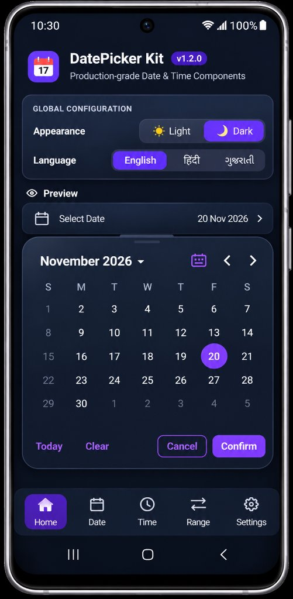 | 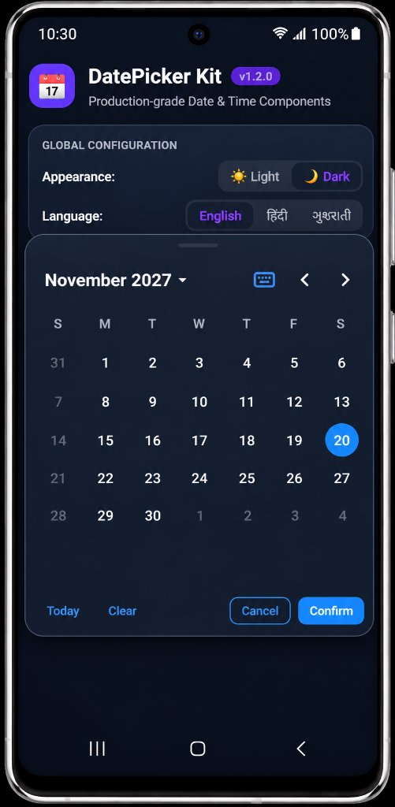 | 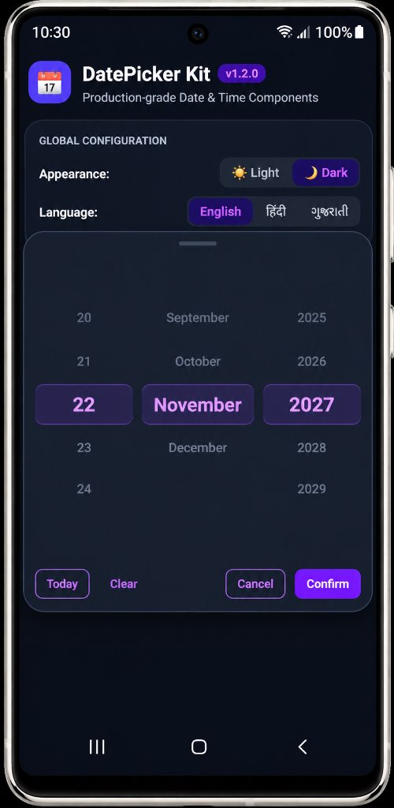 | 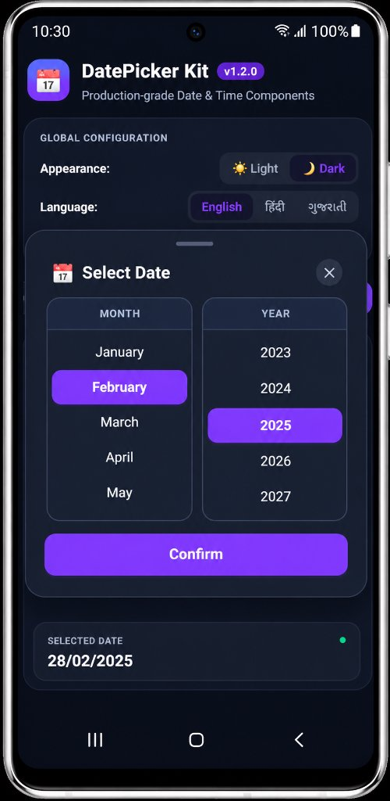 |

### Time & DateTime Pickers
| 12-Hour Time (Wheel) | 24-Hour Military Time | DateTime (Date Tab) | DateTime (Time Tab) |
|:---:|:---:|:---:|:---:|
| 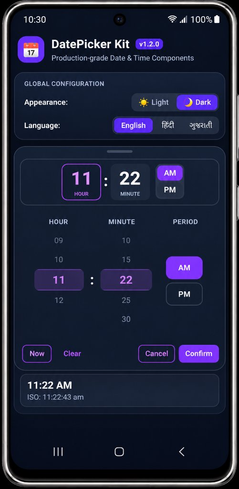 | 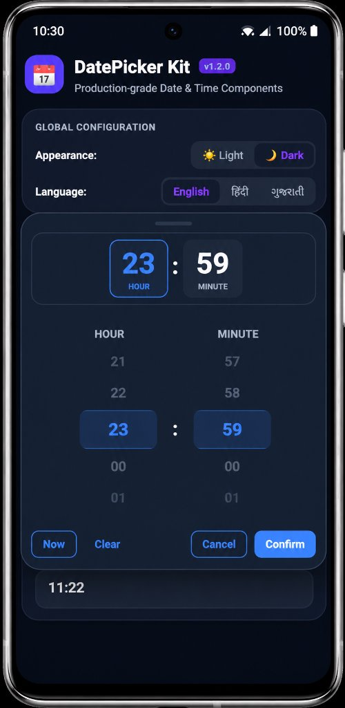 | 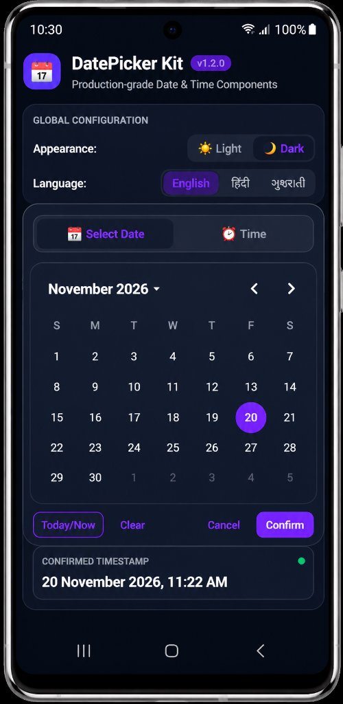 | 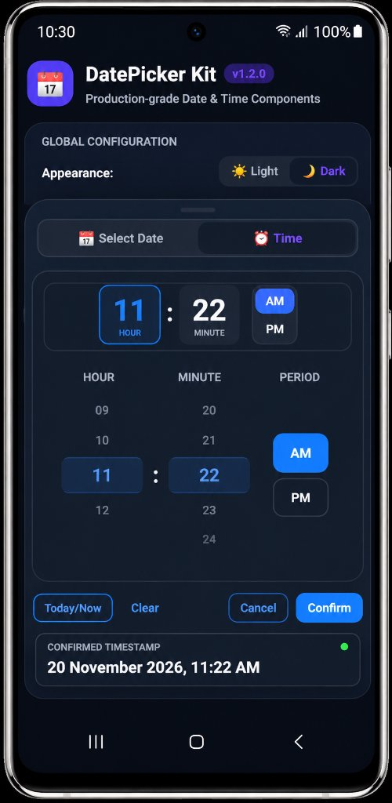 |

### Range & Manual Keyboard Entry Pickers
| Date Range Picker | Input Modal Picker | Manual Entry (Single Box) | Manual Entry (Split Pods) |
|:---:|:---:|:---:|:---:|
| 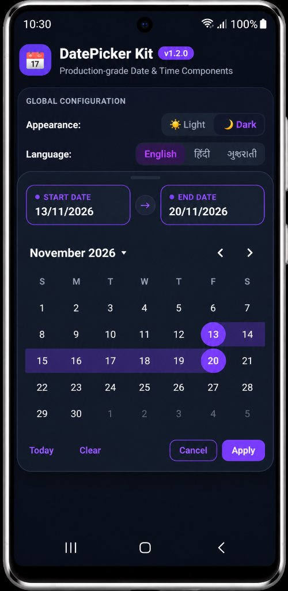 | 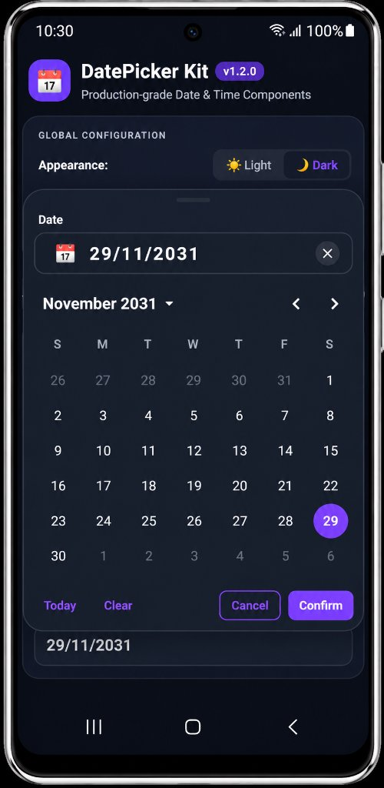 | 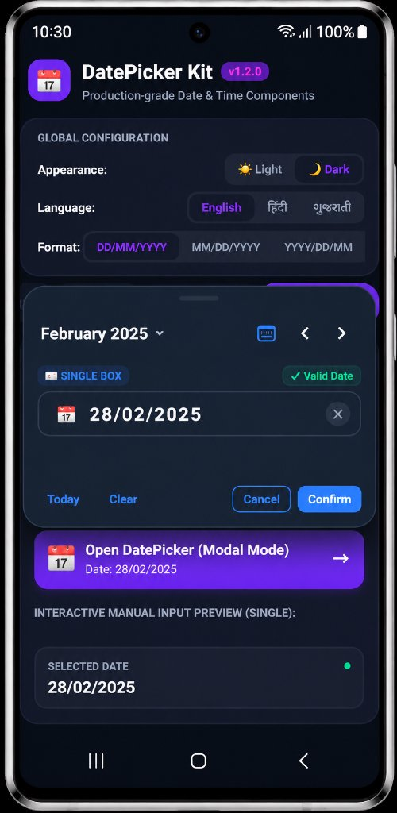 | 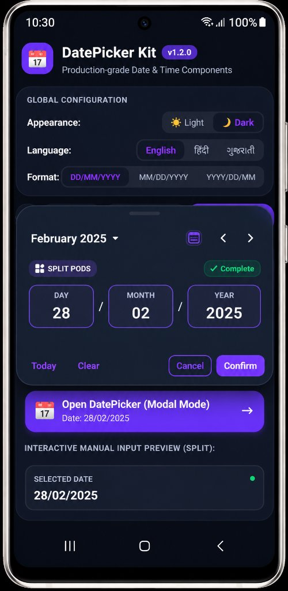 |

</div>

---

## 📋 Table of Contents

- [Live Visual Previews](#-live-visual-previews)
- [Features](#-features)
- [Architecture & Highlights](#-architecture--highlights)
- [Installation](#-installation)
- [Modes Overview](#-modes-overview)
- [Quick Start & Code Examples](#-quick-start--code-examples)
  - [1. Calendar Date Picker (Modal Dialog)](#1-calendar-date-picker-modal-dialog)
  - [2. Wheel Date Picker (3D Inertial Scroll)](#2-wheel-date-picker-3d-inertial-scroll)
  - [3. 12-Hour Time Picker (with AM/PM & Intervals)](#3-12-hour-time-picker-with-ampm--intervals)
  - [4. 24-Hour Military Time Picker (with Seconds)](#4-24-hour-military-time-picker-with-seconds)
  - [5. Analog Clock Dial & Spinner Layout](#5-analog-clock-dial--spinner-layout)
  - [6. Combined Date + Time Picker (DateTime)](#6-combined-date--time-picker-datetime)
  - [7. Date Range Picker (with Ribbon Highlights & Limit)](#7-date-range-picker-with-ribbon-highlights--limit)
  - [8. Input Modal Picker (Tap-to-Open Field)](#8-input-modal-picker-tap-to-open-field)
  - [9. Strict Manual Keyboard Entry (Single Box & Split Pods)](#9-strict-manual-keyboard-entry-single-box--split-pods)
  - [10. Standalone Component Usage](#10-standalone-component-usage)
- [Modal & Color Customization](#-modal--color-customization)
- [Month & Year Fast Navigator Modal](#-month--year-fast-navigator-modal)
- [Dynamic Format Switcher Bar](#-dynamic-format-switcher-bar)
- [Formatting Tokens Reference](#-formatting-tokens-reference)
- [Multilingual Localization](#-multilingual-localization)
- [Themes & Styling Reference](#-themes--styling-reference)
- [Comprehensive Props Reference](#-comprehensive-props-reference)
- [Exported Components & Hooks](#-exported-components--hooks)
- [Testing & Quality Assurance](#-testing--quality-assurance)
- [License](#-license)

---

## ✨ Features

- 📅 **Interactive Calendar Picker**: Full-featured monthly grid with smooth month navigation, previous/next jump, disable filters, and current day indicator.
- 🎡 **3D Wheel Date & Time Picker**: Inertial scrolling wheel columns for Day, Month, Year, Hours, Minutes, and AM/PM with realistic physics and snap feedback.
- 🕒 **12-Hour Time Picker (AM/PM)**: 12-hour digital/wheel clock (01–12) with instant AM/PM toggle, configurable minute intervals (1m, 5m, 15m, 30m), and live preview.
- ⏱️ **24-Hour Military Time Picker**: Military clock navigation (00–23) with optional seconds support (`HH:mm:ss`).
- 🧭 **Analog Clock Dial & Spinner**: Circular analog clock face with fluid angle calculation, dual-circle 24h layout, and visual needle pointers.
- 🗓️ **Unified DateTime Picker**: Seamless synchronization of calendar date and time in one unified tabbed component.
- ↔️ **Continuous Date Range Picker**: Interactive start/end selection cards, continuous highlight ribbon between dates, and `maxRangeDays` limits.
- 📝 **Input Modal & Inline Field**: Clean text input with calendar popup trigger, auto-formatting, and error validation badge.
- ⌨️ **Strict Manual Keyboard Date Entry**:
  - **Single Box**: Format-guided smart typing with auto-masking.
  - **Split Pods**: 3 discrete boxes for Day, Month, and Year with auto-advance focus.
- 🎨 **Live Modal Color Customization**: Complete dynamic color customization (`accentColor`, `primaryColor`, `cardColor`, `modalBackgroundColor`, `modalContentStyle`).
- 🗂️ **Nested Month & Year Selector Modal**: Dedicated 2-column scrollable sheet that automatically closes the parent modal cleanly and restores state without flicker or loop issues.
- 🔘 **Flexible Action Buttons**: `Today` / `Now`, `Clear`, `Cancel`, and `Confirm` / `Apply` buttons with independent visibility toggles.
- 🔤 **Dynamic Format Switcher**: Real-time format switching bar supporting `DD/MM/YYYY`, `MM/DD/YYYY`, `YYYY/DD/MM`, and `YYYY/MM/DD`.
- 🌐 **Built-in Multilingual Localization**: English (`en`), Hindi (`hi`), and Gujarati (`gu`) with custom dictionary support.
- 🌓 **Adaptive Light & Dark Themes**: Pixel-perfect dark and light themes with automatic contrast calculations.
- 🚀 **Zero Native Code**: Runs everywhere React Native runs — iOS, Android, Expo Go, Web (with React Native Web).

---

## 🛠️ Architecture & Highlights

| Feature | Details |
|---|---|
| **Dependencies** | **0 native dependencies**. Pure React Native core (`View`, `Text`, `TouchableOpacity`, `ScrollView`, `Modal`, `StyleSheet`). |
| **Expo Compatibility** | **100% Expo Go ready**. No prebuild, no config plugins, no native modules. |
| **TypeScript** | Written in 100% strict TypeScript with comprehensive type definitions exported. |
| **Performance** | Optimized rendering with `useCallback`, `useMemo`, and ref comparison guards to eliminate unnecessary re-renders. |
| **Test Coverage** | 93 Jest unit tests covering date arithmetic, time parsing, validation constraints, and component rendering. |

---

## 📦 Installation

Install via npm:

```bash
npm install @izonnet-web-solution/react-native-date-picker-kit
```

Or via yarn:

```bash
yarn add @izonnet-web-solution/react-native-date-picker-kit
```

Or via pnpm:

```bash
pnpm add @izonnet-web-solution/react-native-date-picker-kit
```

### Peer Dependencies

Ensure your project has React and React Native installed:

```bash
npm install react react-native
```

- React: `>=18.0.0`
- React Native: `>=0.68.0`

> [!NOTE]
> No `pod install` or native module configuration is required!

---

## 🎯 Modes Overview

The library provides 8 primary modes through the unified `<DatePicker>` component:

| Mode | `mode="..."` | Primary Use Case |
|---|---|---|
| **Calendar** | `'calendar'` | Standard date selection with calendar grid and month navigation |
| **Wheel** | `'wheel'` | Spinning 3D wheel columns for Day, Month, and Year |
| **Time (12h)** | `'time'` (`is24Hour={false}`) | 12-hour time picker with AM/PM toggle and minute intervals |
| **Time (24h)** | `'time'` (`is24Hour={true}`) | 24-hour military time picker with optional seconds |
| **DateTime** | `'datetime'` | Combined Date + Time tabbed picker in one dialog |
| **Range** | `'range'` | Date range selection with start/end cards and highlight ribbon |
| **Input** | `'input'` | Text input field with tap-to-open calendar popup |
| **Manual Entry** | `'calendar'` + `allowManualEntry` | Direct numeric typing via Single Box or Split Pods |

---

## 🚀 Quick Start & Code Examples

### 1. Calendar Date Picker (Modal Dialog)

<div align="center">
  
  &nbsp;&nbsp;&nbsp;&nbsp;
  
</div>

Opens an interactive calendar dialog with Today, Clear, Cancel, and Confirm buttons:

```tsx
import React, { useState } from 'react';
import { View, Button, Text } from 'react-native';
import { DatePicker, formatDate } from '@izonnet-web-solution/react-native-date-picker-kit';

export default function CalendarModalDemo() {
  const [open, setOpen] = useState(false);
  const [date, setDate] = useState<Date | null>(new Date());

  return (
    <View style={{ padding: 20 }}>
      <Button title="Open Calendar" onPress={() => setOpen(true)} />
      <Text style={{ marginTop: 10 }}>
        Selected: {date ? formatDate(date, 'DD/MM/YYYY') : 'None'}
      </Text>

      <DatePicker
        modal
        open={open}
        mode="calendar"
        value={date}
        onChange={setDate}
        onConfirm={(selected) => {
          setDate(selected);
          setOpen(false);
        }}
        onClose={() => setOpen(false)}
        onCancel={() => setOpen(false)}
        accentColor="#4F46E5"
        theme="dark"
        locale="en"
        format="DD/MM/YYYY"
        minimumDate={new Date(2020, 0, 1)}
        maximumDate={new Date(2030, 11, 31)}
      />
    </View>
  );
}
```

---

### 2. Wheel Date Picker (3D Inertial Scroll)

<div align="center">
  
</div>

Smooth Day, Month, and Year spinning wheel columns:

```tsx
import React, { useState } from 'react';
import { View, Button } from 'react-native';
import { DatePicker } from '@izonnet-web-solution/react-native-date-picker-kit';

export default function WheelDateDemo() {
  const [open, setOpen] = useState(false);
  const [date, setDate] = useState<Date | null>(new Date());

  return (
    <View style={{ padding: 20 }}>
      <Button title="Open Wheel Picker" onPress={() => setOpen(true)} />

      <DatePicker
        modal
        open={open}
        mode="wheel"
        value={date}
        onChange={setDate}
        onConfirm={(d) => {
          setDate(d);
          setOpen(false);
        }}
        onClose={() => setOpen(false)}
        accentColor="#8B5CF6"
        minYear={1970}
        maxYear={2050}
        theme="dark"
      />
    </View>
  );
}
```

---

### 3. 12-Hour Time Picker (with AM/PM & Intervals)

<div align="center">
  
</div>

12-hour clock layout with configurable minute intervals (1m, 5m, 15m, 30m):

```tsx
import React, { useState } from 'react';
import { View, Button } from 'react-native';
import { DatePicker } from '@izonnet-web-solution/react-native-date-picker-kit';

export default function Time12Demo() {
  const [open, setOpen] = useState(false);
  const [time, setTime] = useState<Date | null>(new Date());

  return (
    <View style={{ padding: 20 }}>
      <Button title="Pick 12-Hour Time" onPress={() => setOpen(true)} />

      <DatePicker
        modal
        open={open}
        mode="time"
        value={time}
        onChange={setTime}
        onConfirm={(t) => {
          setTime(t);
          setOpen(false);
        }}
        onClose={() => setOpen(false)}
        is24Hour={false}
        minuteInterval={5}
        timePickerLayout="wheel"
        accentColor="#8B5CF6"
        format="hh:mm A"
      />
    </View>
  );
}
```

---

### 4. 24-Hour Military Time Picker (with Seconds)

<div align="center">
  
</div>

Complete 24-hour clock (00–23) with optional seconds display:

```tsx
import React, { useState } from 'react';
import { View, Button } from 'react-native';
import { DatePicker } from '@izonnet-web-solution/react-native-date-picker-kit';

export default function Time24Demo() {
  const [open, setOpen] = useState(false);
  const [time, setTime] = useState<Date | null>(new Date());

  return (
    <View style={{ padding: 20 }}>
      <Button title="Pick 24-Hour Time" onPress={() => setOpen(true)} />

      <DatePicker
        modal
        open={open}
        mode="time"
        value={time}
        onChange={setTime}
        onConfirm={(t) => {
          setTime(t);
          setOpen(false);
        }}
        onClose={() => setOpen(false)}
        is24Hour={true}
        showSeconds={true}
        format="HH:mm:ss"
        accentColor="#0EA5E9"
        theme="dark"
      />
    </View>
  );
}
```

---

### 5. Analog Clock Dial & Spinner Layout

Analog circular clock face with smooth angle calculation and visual needle pointers:

```tsx
import React, { useState } from 'react';
import { View, Button } from 'react-native';
import { DatePicker } from '@izonnet-web-solution/react-native-date-picker-kit';

export default function AnalogClockDemo() {
  const [open, setOpen] = useState(false);
  const [time, setTime] = useState<Date | null>(new Date());

  return (
    <View style={{ padding: 20 }}>
      <Button title="Open Analog Clock" onPress={() => setOpen(true)} />

      <DatePicker
        modal
        open={open}
        mode="time"
        timePickerLayout="spinner"
        value={time}
        onChange={setTime}
        onConfirm={(t) => {
          setTime(t);
          setOpen(false);
        }}
        onClose={() => setOpen(false)}
        accentColor="#F59E0B"
        format="hh:mm A"
      />
    </View>
  );
}
```

---

### 6. Combined Date + Time Picker (DateTime)

<div align="center">
  
  &nbsp;&nbsp;&nbsp;&nbsp;
  
</div>

Cohesive date and time synchronization in one unified dialog:

```tsx
import React, { useState } from 'react';
import { View, Button } from 'react-native';
import { DatePicker } from '@izonnet-web-solution/react-native-date-picker-kit';

export default function DateTimeDemo() {
  const [open, setOpen] = useState(false);
  const [dateTime, setDateTime] = useState<Date | null>(new Date());

  return (
    <View style={{ padding: 20 }}>
      <Button title="Pick Date & Time" onPress={() => setOpen(true)} />

      <DatePicker
        modal
        open={open}
        mode="datetime"
        value={dateTime}
        onChange={setDateTime}
        onConfirm={(dt) => {
          setDateTime(dt);
          setOpen(false);
        }}
        onClose={() => setOpen(false)}
        is24Hour={false}
        minuteInterval={15}
        format="DD/MM/YYYY hh:mm A"
        accentColor="#4F46E5"
        theme="dark"
      />
    </View>
  );
}
```

---

### 7. Date Range Picker (with Ribbon Highlights & Limit)

<div align="center">
  
</div>

Select start date and end date with interactive cards, direction arrow, range highlight ribbon, and maximum span limits:

```tsx
import React, { useState } from 'react';
import { View, Button } from 'react-native';
import { DatePicker, DateRange } from '@izonnet-web-solution/react-native-date-picker-kit';

export default function DateRangeDemo() {
  const [open, setOpen] = useState(false);
  const [range, setRange] = useState<DateRange>({
    startDate: new Date(),
    endDate: new Date(Date.now() + 7 * 24 * 60 * 60 * 1000),
  });

  return (
    <View style={{ padding: 20 }}>
      <Button title="Select Date Range" onPress={() => setOpen(true)} />

      <DatePicker
        modal
        open={open}
        mode="range"
        startDate={range.startDate}
        endDate={range.endDate}
        onRangeChange={setRange}
        onConfirm={(r) => {
          if (r) setRange(r);
          setOpen(false);
        }}
        onClose={() => setOpen(false)}
        maxRangeDays={14}
        accentColor="#8B5CF6"
        theme="dark"
      />
    </View>
  );
}
```

---

### 8. Input Modal Picker (Tap-to-Open Field)

<div align="center">
  
</div>

A clean interactive input box with calendar icon that opens a synchronized popup picker:

```tsx
import React, { useState } from 'react';
import { View } from 'react-native';
import { DatePicker } from '@izonnet-web-solution/react-native-date-picker-kit';

export default function InputPickerDemo() {
  const [date, setDate] = useState<Date | null>(new Date());

  return (
    <View style={{ padding: 20 }}>
      <DatePicker
        mode="input"
        value={date}
        onChange={setDate}
        onConfirm={setDate}
        label="Appointment Date"
        format="DD/MM/YYYY"
        allowManualEntry={true}
        accentColor="#8B5CF6"
      />
    </View>
  );
}
```

---

### 9. Strict Manual Keyboard Entry (Single Box & Split Pods)

<div align="center">
  
  &nbsp;&nbsp;&nbsp;&nbsp;
  
</div>

Enables direct numeric typing with validation feedback for leap years and month boundaries:

#### Single Box Mode:
```tsx
<DatePicker
  modal
  open={open}
  mode="calendar"
  defaultManualMode={true}
  allowManualEntry={true}
  manualEntryType="single"
  value={date}
  onChange={setDate}
  format="DD/MM/YYYY"
  accentColor="#4F46E5"
/>
```

#### Split Pods Mode (Day, Month, Year discrete boxes with auto-focus):
```tsx
<DatePicker
  modal
  open={open}
  mode="calendar"
  defaultManualMode={true}
  allowManualEntry={true}
  manualEntryType="split"
  value={date}
  onChange={setDate}
  format="DD/MM/YYYY"
  accentColor="#4F46E5"
/>
```

---

### 10. Standalone Component Usage

All sub-components are exported independently for custom layouts:

```tsx
import {
  Calendar,
  WheelPicker,
  RangePicker,
  TimePicker,
  ClockDial,
  DateTimePicker,
  DateInput,
  ManualDateInput,
  MonthYearSelectorModal,
} from '@izonnet-web-solution/react-native-date-picker-kit';
```

---

## 🎨 Modal & Color Customization

The library provides fine-grained control over colors and styles. When you specify `accentColor`, all primary components automatically adapt to that color:

```tsx
<DatePicker
  modal
  open={open}
  accentColor="#F43F5E"           // Selected circles, buttons, highlights, dial needle
  cardColor="#1E293B"             // Modal dialog background color
  modalBackgroundColor="#1E293B" // Dedicated modal container background
  textColor="#F8FAFC"             // Primary text color
  borderRadius={20}               // Modal & button corner radius
  modalContentStyle={{            // Custom styling for inner modal container
    paddingHorizontal: 20,
    borderWidth: 1,
    borderColor: 'rgba(255,255,255,0.1)',
  }}
  theme="dark"
  ...
/>
```

### What `accentColor` Controls:
1. **Calendar**: Selected date circle background, Today indicator border and text.
2. **Month & Year Selector**: Active month and year pill background, Confirm button background.
3. **Range Picker**: Start and end date circles, connection ribbon background (`${accentColor}20`).
4. **Time Picker / Clock Dial**: Selected hour/minute pills, analog clock needle, AM/PM active switch.
5. **Action Buttons**: `Confirm` / `Apply` button background, `Today` and `Clear` button text, `Cancel` button border.
6. **Input Fields**: Focus borders and calendar accessory icons.

---

## 🗂️ Month & Year Fast Navigator Modal

<div align="center">
  
</div>

Tap the month header (e.g. **"November 2026 ▾"**) on any calendar to open the dedicated Month & Year selection sheet:
- Two smooth scrollable columns: **MONTH** (January to December) and **YEAR** (minYear to maxYear).
- **Auto-scroll**: Automatically scrolls to the currently selected month and year on open.
- **Nested Modal Transition**: If the calendar is inside a modal dialog, the parent modal hides smoothly while the Month & Year selector is open and re-opens seamlessly upon Confirm or Close — preventing stacked modal conflicts or selection loss.

---

## 🔤 Dynamic Format Switcher Bar

Allow users to switch date formats on the fly by enabling `showFormatSelector`:

```tsx
<DatePicker
  mode="calendar"
  showFormatSelector={true}
  supportedFormats={['DD/MM/YYYY', 'MM/DD/YYYY', 'YYYY/DD/MM', 'YYYY/MM/DD']}
  onFormatChange={(newFormat) => console.log('Format changed:', newFormat)}
  ...
/>
```

---

## 🔤 Formatting Tokens Reference

### Date Tokens
| Token | Description | Example |
|---|---|---|
| `YYYY` | 4-digit full year | `2026` |
| `YY` | 2-digit short year | `26` |
| `MMMM` | Full month name | `November` |
| `MMM` | Short 3-letter month name | `Nov` |
| `MM` | 2-digit month with leading zero | `01` – `12` |
| `M` | 1-digit month | `1` – `12` |
| `DD` | 2-digit day of month | `01` – `31` |
| `D` | 1-digit day of month | `1` – `31` |
| `dddd` | Full weekday name | `Friday` |
| `ddd` | Short weekday name | `Fri` |
| `dd` | Minimized weekday name | `Fr` |

### Time Tokens
| Token | Description | Example |
|---|---|---|
| `HH` | 2-digit 24-hour clock | `00` – `23` |
| `H` | 1-digit 24-hour clock | `0` – `23` |
| `hh` | 2-digit 12-hour clock | `01` – `12` |
| `h` | 1-digit 12-hour clock | `1` – `12` |
| `mm` | 2-digit minute | `00` – `59` |
| `m` | 1-digit minute | `0` – `59` |
| `ss` | 2-digit second | `00` – `59` |
| `s` | 1-digit second | `0` – `59` |
| `A` | Uppercase meridiem | `AM` / `PM` |
| `a` | Lowercase meridiem | `am` / `pm` |

---

## 🌐 Multilingual Localization

Built-in translation dictionaries:
- **English** (`'en'`) — Default
- **Hindi** (`'hi'`)
- **Gujarati** (`'gu'`)

```tsx
<DatePicker
  locale="hi"    // Hindi labels ("आज", "साफ़ करें", "रद्द करें", "पुष्टि करें")
  ...
/>
```

### Custom Locale Dictionary
You can pass a custom `DatePickerLocale` object:

```tsx
import type { DatePickerLocale } from '@izonnet-web-solution/react-native-date-picker-kit';

const frenchLocale: DatePickerLocale = {
  code: 'fr',
  months: ['Janvier', 'Février', 'Mars', 'Avril', 'Mai', 'Juin', 'Juillet', 'Août', 'Septembre', 'Octobre', 'Novembre', 'Décembre'],
  monthsShort: ['Jan', 'Fév', 'Mar', 'Avr', 'Mai', 'Juin', 'Juil', 'Août', 'Sep', 'Oct', 'Nov', 'Déc'],
  weekdays: ['Dimanche', 'Lundi', 'Mardi', 'Mercredi', 'Jeudi', 'Vendredi', 'Samedi'],
  weekdaysShort: ['Dim', 'Lun', 'Mar', 'Mer', 'Jeu', 'Ven', 'Sam'],
  weekdaysMin: ['Di', 'Lu', 'Ma', 'Me', 'Je', 'Ve', 'Sa'],
  today: "Aujourd'hui",
  clear: 'Effacer',
  cancel: 'Annuler',
  confirm: 'Confirmer',
  apply: 'Appliquer',
  selectDate: 'Sélectionner une date',
  monthLabel: 'MOIS',
  yearLabel: 'ANNÉE',
  errors: {
    invalidDate: 'Date invalide',
    outOfRange: 'Date hors limites',
    minDate: 'La date ne peut pas être antérieure au minimum',
    maxDate: 'La date ne peut pas dépasser le maximum',
    disabledDate: 'Cette date est désactivée',
    disabledWeekday: 'Ce jour est désactivé',
    startDateAfterEndDate: 'La date de début doit précéder la date de fin',
    maxRangeExceeded: 'Plage maximale dépassée',
    invalidTime: 'Heure invalide',
    minTime: "L'heure ne peut pas être antérieure au minimum",
    maxTime: "L'heure ne peut pas dépasser le maximum",
  },
};

<DatePicker locale={frenchLocale} ... />
```

---

## 🎨 Themes & Styling Reference

### Predefined Themes
- `theme="light"` (Default clean white background with slate text)
- `theme="dark"` (High-contrast obsidian theme with subtle borders)

### `DatePickerTheme` Object Properties

```typescript
interface DatePickerTheme {
  backgroundColor: string;
  surfaceColor: string;
  cardColor: string;
  primaryColor: string;
  primaryTextColor: string;
  textColor: string;
  secondaryTextColor: string;
  disabledTextColor: string;
  borderColor: string;
  selectedDayBackgroundColor: string;
  selectedDayTextColor: string;
  todayBorderColor: string;
  todayTextColor: string;
  rangeBetweenBackgroundColor: string;
  rangeBetweenTextColor: string;
  errorColor: string;
  errorBackgroundColor: string;
  borderRadius: number;
  fontSize: {
    small: number;
    medium: number;
    large: number;
    title: number;
  };
}
```

---

## 📖 Comprehensive Props Reference

### Core & Presentation Props

| Prop | Type | Default | Description |
|---|---|---|---|
| `mode` | `'calendar' \| 'wheel' \| 'range' \| 'input' \| 'time' \| 'datetime'` | `'calendar'` | Primary picker mode |
| `modal` | `boolean` | `false` | When `true`, presents picker in a popup modal dialog |
| `open` | `boolean` | `false` | Controls visibility in modal mode |
| `format` | `DateFormat` | `'DD/MM/YYYY'` | Date/Time format string |
| `theme` | `'light' \| 'dark' \| Partial<DatePickerTheme>` | `'light'` | Color theme or partial theme object |
| `locale` | `'en' \| 'hi' \| 'gu' \| DatePickerLocale` | `'en'` | Active language code or custom locale dictionary |
| `accentColor` | `string` | `undefined` | Live primary accent color override |
| `primaryColor` | `string` | `undefined` | Alias for `accentColor` |
| `cardColor` | `string` | `undefined` | Card / modal container background color |
| `modalBackgroundColor`| `string` | `undefined` | Dedicated modal container background override |
| `modalContentStyle` | `StyleProp<ViewStyle>` | `undefined` | Custom style applied to the modal dialog card |
| `borderRadius` | `number` | `12` | Corner radius override for cards and buttons |
| `style` | `StyleProp<ViewStyle>` | `undefined` | Custom container style |
| `testID` | `string` | `undefined` | Test identifier for automated testing |

### Single Date & Calendar Props

| Prop | Type | Default | Description |
|---|---|---|---|
| `value` | `Date \| null` | `null` | Currently selected date value |
| `defaultValue` | `Date \| null` | `null` | Initial date value |
| `onChange` | `(date: Date \| null) => void` | `undefined` | Fired when date selection changes |
| `minimumDate` | `Date` | `undefined` | Earliest selectable date boundary |
| `maximumDate` | `Date` | `undefined` | Latest selectable date boundary |
| `disabledDates` | `(Date \| string)[] \| ((d: Date) => boolean)` | `undefined` | Array of disabled dates or filter function |
| `disabledWeekdays` | `number[]` | `undefined` | Days of week to disable (`0` = Sun, `6` = Sat) |
| `firstDayOfWeek` | `0 \| 1 \| 2 \| 3 \| 4 \| 5 \| 6` | `0` | Column start day (`0` = Sun, `1` = Mon) |
| `autoCloseOnSelect` | `boolean` | `false` | Automatically confirm and close modal upon date cell tap |

### Range Picker Props (`mode="range"`)

| Prop | Type | Default | Description |
|---|---|---|---|
| `startDate` | `Date \| null` | `null` | Range start date |
| `endDate` | `Date \| null` | `null` | Range end date |
| `defaultStartDate` | `Date \| null` | `null` | Initial start date |
| `defaultEndDate` | `Date \| null` | `null` | Initial end date |
| `onRangeChange` | `(range: DateRange) => void` | `undefined` | Fired when range changes |
| `maxRangeDays` | `number` | `undefined` | Maximum allowed range span in days |

### Time & DateTime Props (`mode="time"` / `mode="datetime"`)

| Prop | Type | Default | Description |
|---|---|---|---|
| `is24Hour` | `boolean` | `false` | Enable 24-hour military clock or 12-hour AM/PM mode |
| `minuteInterval` | `1 \| 2 \| 3 \| 4 \| 5 \| 6 \| 10 \| 12 \| 15 \| 20 \| 30` | `1` | Minute step intervals |
| `minimumTime` | `string \| Date` | `undefined` | Earliest allowable time (e.g. `"09:00 AM"` or `"09:00"`) |
| `maximumTime` | `string \| Date` | `undefined` | Latest allowable time (e.g. `"06:00 PM"` or `"18:00"`) |
| `showSeconds` | `boolean` | `false` | Show seconds column in time modes |
| `timePickerLayout` | `'wheel' \| 'spinner' \| 'input' \| 'segmented'` | `'wheel'` | Time picker presentation style |
| `initialTab` | `'date' \| 'time'` | `'date'` | Default active tab in datetime mode |

### Wheel Picker Props (`mode="wheel"`)

| Prop | Type | Default | Description |
|---|---|---|---|
| `minYear` | `number` | `1970` | Minimum selectable year |
| `maxYear` | `number` | `2050` | Maximum selectable year |

### Manual Input & Validation Props

| Prop | Type | Default | Description |
|---|---|---|---|
| `allowManualEntry` | `boolean` | `false` | Show keyboard toggle button in calendar header |
| `defaultManualMode` | `boolean` | `false` | Start with manual input view enabled by default |
| `manualEntryType` | `'single' \| 'split'` | `'single'` | Single text box vs 3 separate Day/Month/Year boxes |
| `placeholder` | `string` | `undefined` | Input placeholder text (`mode="input"`) |
| `label` | `string` | `undefined` | Input field label (`mode="input"`) |
| `editable` | `boolean` | `true` | Enable or disable input editing (`mode="input"`) |

### Action Button & Callback Props

| Prop | Type | Default | Description |
|---|---|---|---|
| `showActionButtons` | `boolean` | `true` | Show footer action button row |
| `showTodayButton` | `boolean` | `true` | Show `Today` / `Now` button |
| `showClearButton` | `boolean` | `true` | Show `Clear` button |
| `showCancelButton` | `boolean` | `true` | Show `Cancel` button |
| `showConfirmButton` | `boolean` | `true` | Show `Confirm` / `Apply` button |
| `onConfirm` | `(value: any) => void` | `undefined` | Callback fired on Confirm / Apply press |
| `onCancel` | `() => void` | `undefined` | Callback fired on Cancel press |
| `onClear` | `() => void` | `undefined` | Callback fired on Clear press |
| `onClose` | `() => void` | `undefined` | Callback fired when modal is dismissed |

### Format Switcher Props

| Prop | Type | Default | Description |
|---|---|---|---|
| `showFormatSelector` | `boolean` | `false` | Show format pills row above picker |
| `supportedFormats` | `DateFormat[]` | `['DD/MM/YYYY', 'MM/DD/YYYY', 'YYYY/DD/MM', 'YYYY/MM/DD']` | List of selectable formats |
| `onFormatChange` | `(format: DateFormat) => void` | `undefined` | Callback fired when format is changed |

---

## 📦 Exported Components & Hooks

### Components
- `DatePicker`: Main versatile picker component supporting all 8 modes.
- `Calendar`: Month grid calendar component.
- `WheelPicker`: 3D-feel Day/Month/Year wheel date picker.
- `RangePicker`: Date range picker component.
- `TimePicker`: Standalone time picker with dial and wheel layouts.
- `ClockDial`: Analog clock face component.
- `WheelTimePicker`: Wheel-based time picker.
- `DateTimePicker`: Combined date and time picker.
- `DateInput`: Text input field with embedded calendar icon.
- `ManualDateInput`: Manual keyboard entry component (Single & Split).
- `MonthYearSelectorModal`: Two-column month and year selector modal.
- `Modal`: Lightweight accessible backdrop modal dialog.
- `Button`: Themed button component.
- `IconButton`: Accessible icon button.

### Utility Functions
- `formatDate(date, format, locale)`: Format Date object to tokenized string.
- `parseDate(dateString, format)`: Parse formatted string into Date object.
- `validateDate(date, options)`: Validate date against boundaries and disable rules.
- `isSameDay(date1, date2)`: Compare if two dates share the same day.
- `isToday(date)`: Check if date is today.
- `addDays(date, days)` / `subDays(date, days)`: Date addition/subtraction.
- `getDaysInMonth(year, month)`: Get number of days in specified month.

### Hooks
- `useDatePicker`: Complete state management for calendar selection and manual entry.
- `useDateRange`: State management for date range selection.
- `useTimePicker`: State management for 12h/24h time selection and clock angle math.

---

## 🧪 Testing & Quality Assurance

The library comes with comprehensive Jest unit test suites covering:
- Date arithmetic & leap year calculations
- Format token parsing and serialization
- Range boundaries and max days constraint validation
- Business hours & operating time constraints
- Component mounting, user interactions, and callbacks

Run the test suite:

```bash
npm test
```

Build declarations and bundles:

```bash
npm run build
```

---

## 📄 License

MIT © [Izonnet Web Solution](https://github.com/Izonnet-Web-Solution)  
Authored by Jenil.
