# DatePicker Kit Demo App

<div align="center">


**Interactive showcase and testing application for `@izonnet-web-solution/react-native-date-picker-kit`.**  
Explore all 8 picker modes, live color customization, multilingual localization, format switching, and modal dialog interactions.

</div>

---

## 📸 Screenshots & Visual Previews

<div align="center">

### Date Pickers & Month/Year Selector
| Calendar (Violet) | Calendar (Sky Blue) | Wheel Date Picker | Month & Year Fast Modal |
|:---:|:---:|:---:|:---:|
| 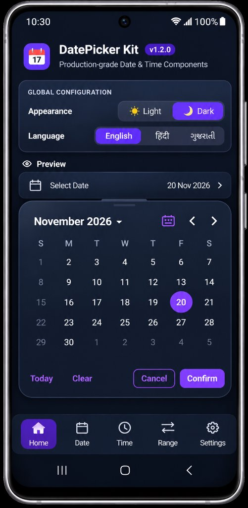 | 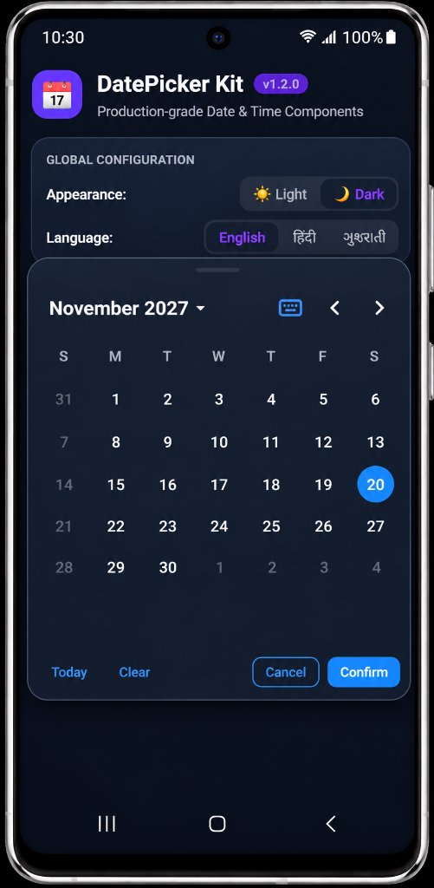 | 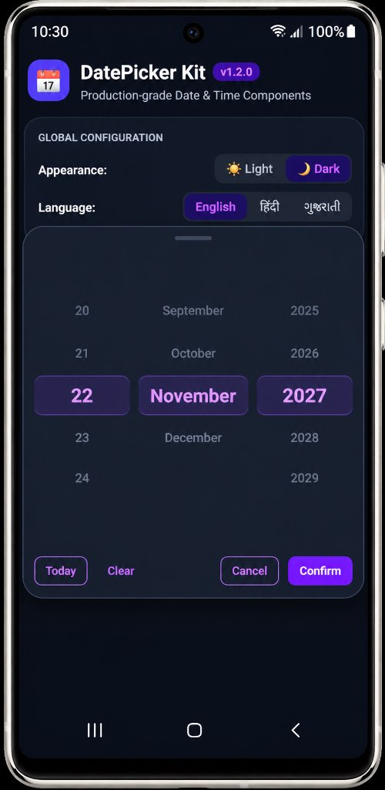 | 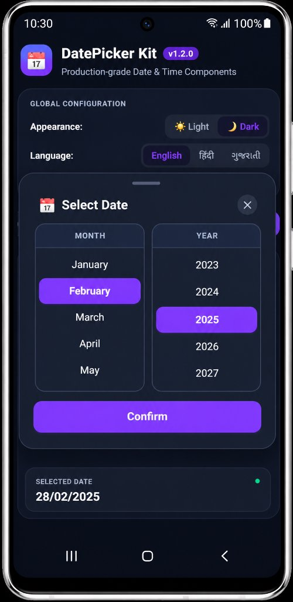 |

### Time & DateTime Pickers
| 12-Hour Time (Wheel) | 24-Hour Military Time | DateTime (Date Tab) | DateTime (Time Tab) |
|:---:|:---:|:---:|:---:|
| 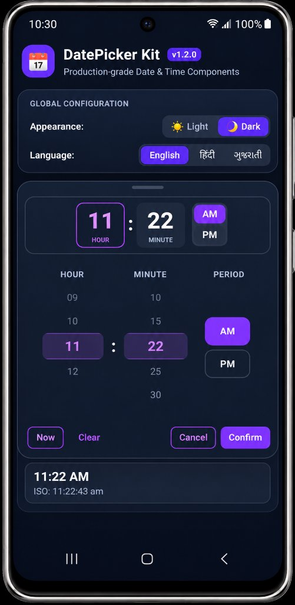 | 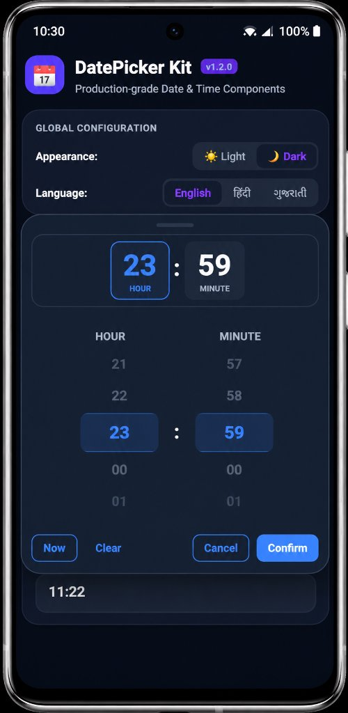 | 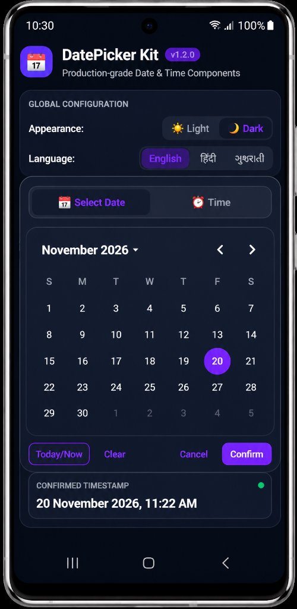 | 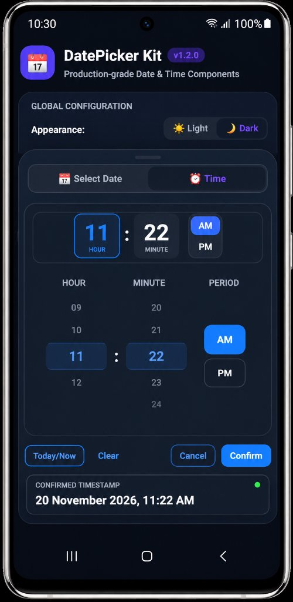 |

### Range & Manual Keyboard Entry Pickers
| Date Range Picker | Input Modal Picker | Manual Entry (Single Box) | Manual Entry (Split Pods) |
|:---:|:---:|:---:|:---:|
| 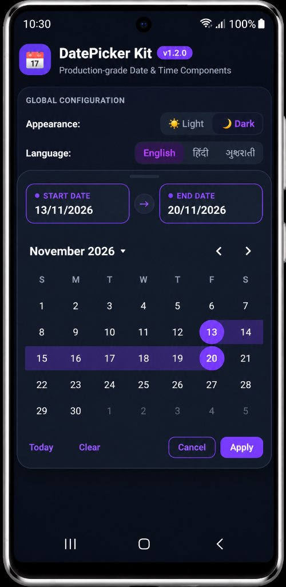 | 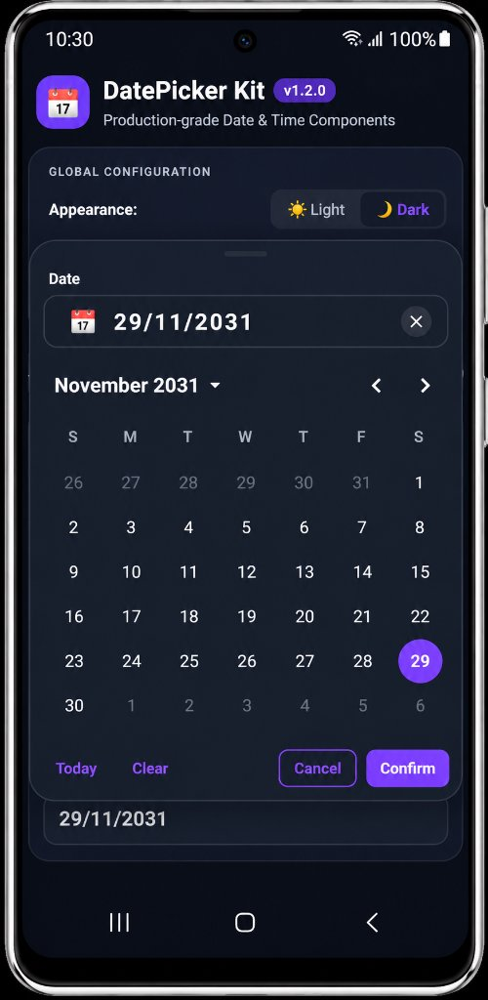 | 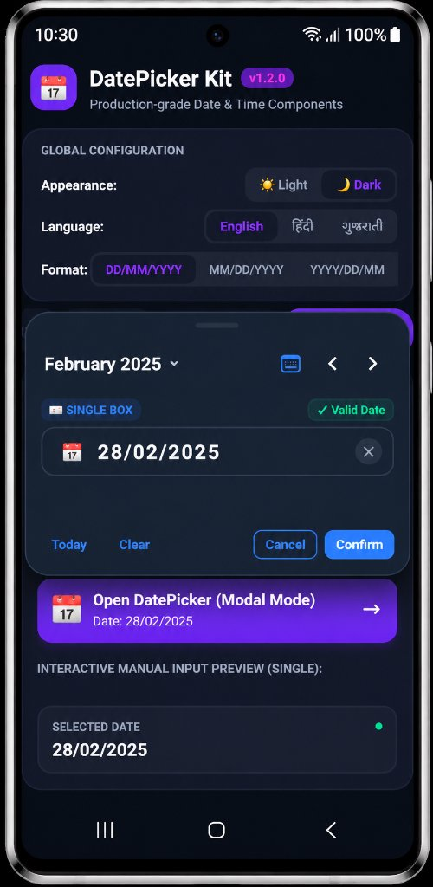 | 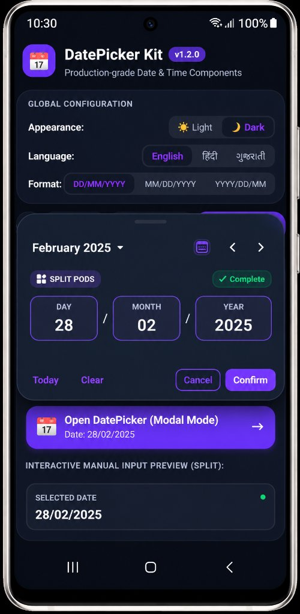 |

</div>

---

## 🚀 Getting Started

Follow these steps to run the demo app locally:

### 1. Install Dependencies

From the repository root or demo directory:

```bash
cd date-picker-demo
npm install
```

### 2. Start Metro Bundler

```bash
npm start
```

### 3. Run on Device or Emulator

#### Android:
```bash
npm run android
```

#### iOS:
```bash
# Install CocoaPods for iOS (first time or when updating native dependencies)
cd ios && pod install && cd ..

# Run iOS Simulator
npm run ios
```

---

## 🎛️ Interactive Features Demonstrated in this App

### 1. Global Configuration Card (Top Section)
- 🌓 **Appearance Mode**: Toggle between **Light** and **Dark** themes.
- 🌐 **Language / Locale Switcher**: Instant switching between:
  - **English** (`en`)
  - **हिंदी** (`hi`)
  - **ગુજરાતી** (`gu`)
- 🔤 **Format Switcher Bar**: Live date token testing:
  - `DD/MM/YYYY`
  - `MM/DD/YYYY`
  - `YYYY/DD/MM`
  - `YYYY/MM/DD`
- 🎨 **Modal Color Customizer**: Live 8-color preset selector:
  - 🟣 **Indigo** (`#4F46E5`)
  - 🟢 **Emerald** (`#10B981`)
  - 🟣 **Violet** (`#8B5CF6`)
  - 🌹 **Rose** (`#F43F5E`)
  - 🟠 **Amber** (`#F59E0B`)
  - 🔵 **Sky Blue** (`#0EA5E9`)
  - 🩵 **Teal** (`#14B8A6`)
  - 🔴 **Crimson** (`#EF4444`)  
  *Tapping any color immediately updates every modal dialog, calendar highlights, and buttons across all tabs!*

---

### 2. Feature Tabs Breakdown

| Tab | Key Highlights Demonstrated |
|---|---|
| **📅 Calendar** | Modal calendar dialog, month navigation, Sunday disabled, min/max date limits, Today/Clear/Cancel/Confirm actions |
| **🎡 Wheel Date** | Smooth Day, Month, and Year spinning wheel columns with inertial scrolling |
| **🕒 Time (12H)** | 12-hour clock (01–12), instant AM/PM toggle, minute interval pills (1m, 5m, 15m, 30m) |
| **⏱️ Time (24H)** | 24-hour military clock (00–23), seconds toggle pill (`HH:mm:ss`) |
| **🧭 Spinner Dial** | Analog clock face with touch angle needle pointer |
| **🗓️ DateTime** | Unified tabbed dialog (`Select Date` & `Time`), synced live timestamp output |
| **↔️ Date Range** | Start Date and End Date cards, connecting range ribbon, `maxRangeDays={14}` limit |
| **📝 Input Picker** | Prominent modal launch card + inline interactive text field with calendar popup icon |
| **⌨️ Manual Input** | Live switcher between **Single Box** auto-masking and **Split Pods** (Day/Month/Year separate boxes) |

---

## 🔗 Architecture & Local Development

In `metro.config.js`, `@izonnet-web-solution/react-native-date-picker-kit` resolves directly to `../src/index.ts`. This means:
- Any edits made in `../src/` are immediately picked up via **Fast Refresh** in this demo app without needing to rebuild or reinstall packages.

---

## 📄 License

MIT © [Izonnet Web Solution](https://github.com/Izonnet-Web-Solution)  
Authored by Jenil.
